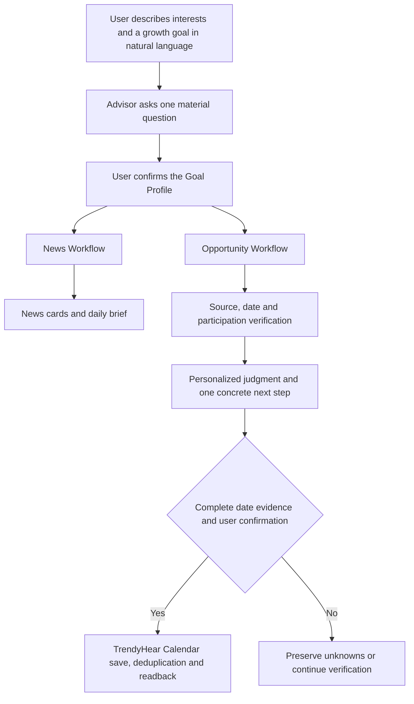

# TrendyHear

**Personal Motion Agent · Follow what you care about. Understand today. Turn important information into meaningful action.**

[简体中文](README.md) · Final-round submission **v0.9.0** · SkyStream · [Apache-2.0](LICENSE)

TrendyHear is a news-driven personal growth agentic app built for OctoSense. It selects public news and action opportunities related to a user's goals. Its advisor, Xiao Jiao, then combines source evidence with confirmed personal context to help answer two questions: **What does this mean for me? What is the most useful thing I can do next?**

> The future of information is not about consuming more, but about turning the right information into meaningful action.

**TrendyHear is positioned as a Personal Motion Agent.** **Xiao Jiao (小蕉, the TrendyHear Advisor)** is its personified companion, responsible for understanding needs and helping users discover relevant information and opportunities to act.

The name Xiao Jiao plays on the similar sounds of `蕉`, banana, and `焦` in `焦虑`, anxiety. The character responds to the personal uncertainty created by information overload: reducing aimless noise and turning trustworthy leads into next steps that can be checked, decided and carried out.

## Release status

v0.9.0 is the frozen final-round submission version. Development and local installation target OctoSense `desktop-v0.1.0-rc.6-3-g243ee8c8`. This repository contains the app source, Apache-2.0 license, startup instructions, key screenshots, product brief, source and limitation notes, reproducible results, and failure-state records. The contestant will add the demo video separately.

The local package uses an existing test trust chain only for isolated on-device review. It is neither a public App Hub release nor proof of official acceptance. Live news, model output, real-time opportunity sources and final UI behavior must still be reviewed manually in the fixed package.

## Product evolution: From information to action

During the first round, TrendyHear was a news aggregation tool that helped users obtain and understand information and receive cards on demand. For the final round, we reconsidered where a news product should ultimately lead.

**If information is only read and then forgotten, how much real growth can more news create?**

Version 0.9.0 therefore evolves TrendyHear into a **Personal Motion Agent** guided by personal growth goals. Users can tell TrendyHear what they care about and what they hope to achieve. TrendyHear uses that intent to select news, create a daily brief, and look for action opportunities related to the confirmed goal.

For example, when a user wants to learn AI Agent development, TrendyHear can surface relevant trends, look for developer events, competitions or research projects, verify participation requirements and important dates, and then propose one concrete next step based on confirmed personal context.

Through the in-app TrendyHear Calendar, with user confirmation, date evidence, deduplication, saving and readback, valuable information can continue into a plan that is both checkable and schedulable.

**From intent to information, and from information to action.**

## Product flow



**Natural-language intent → goal structuring → user confirmation → dual-workflow execution → fact and evidence verification → personalized judgment → user authorization → action execution → result readback.**

1. **Understand intent.** The user describes interests, growth goals and real-world constraints in natural language. The advisor extracts the goal, current priority and optional personal context. It asks one low-effort question only when the missing answer could materially change the recommendation.
2. **Confirm the goal.** The advisor first creates a Goal Profile confirmation card. The goal revision, interests and authorized personal context are saved only after the user confirms them. Every later step refers to this confirmed state.
3. **Coordinate execution.** The outer advisor starts the News and Opportunity workflows with the same goal revision. Either workflow may succeed, fail or return no results independently, without waiting for unrelated output from the other.
4. **Process news.** The News Workflow reads RSS feeds concurrently, parses formats, removes duplicate events, filters semantically and ranks relevance before producing news cards and a text daily brief.
5. **Discover and verify opportunities.** The Opportunity Workflow reads event sources concurrently, merges candidates and checks page evidence. Event name, eligibility, registration status, format, deadlines, deliverables and project reuse rules are stored separately as `verified`, `unverified` or `unknown`. A malformed source is isolated from the rest of the run.
6. **Form a personal judgment.** The advisor uses only the confirmed goal, authorized personal context and event evidence. It evaluates goal value, personal conditions, practical obstacles and the single most useful next action. Missing facts remain explicitly unknown.
7. **Support the decision.** Personalized analysis appears directly on each opportunity card. News and opportunities are linked only when source facts, event requirements or the user's goal provide a clear basis. The user can verify further, save, dismiss or prepare to act.
8. **Execute and verify the result.** For an opportunity with complete date evidence, the Action Layer writes to the TrendyHear Calendar only after user confirmation, then deduplicates, saves and reads the item back. If evidence is incomplete, confirmation is absent or saving fails, the workflow remains in a verification or failure state and does not produce a success receipt.

The workflow preserves context through goal revisions, source evidence, task state, user confirmations and execution receipts. Each structured result becomes a constrained input to the next step, allowing information discovery to continue into value judgment and action. Version 0.9.0 uses one outer TrendyHear Advisor to coordinate two internal workflows that share the Goal Profile, evidence state and Action Layer.

News and Opportunity remain separate workflows with one shared confirmed goal. TrendyHear does not connect news and events merely because their topics look similar; a connection requires support from source facts, event requirements or the user's goal.

## Core capabilities

### 1. Natural-language goals and lightweight personal context

Users can tell the advisor what they care about, what they want to achieve and which constraints matter. The advisor first summarizes the request in a confirmation card. Configuration changes only after the user selects **Confirm and save**.

- Supports politics, business, technology, society, culture, education and custom interests.
- Opportunity discovery covers conferences, competitions, research projects and internships by default; the advisor uses one low-effort question to learn a preference when useful.
- Current stage, existing resources and practical constraints are optional.
- Personal context must cite the user's own words or a confirmed record. Unknown experience, ability, time or budget is never filled in by the model.

### 2. Today news and text brief

The Today page selects up to eight relevant or adjacent articles from public RSS feeds. Each card shows its domain, title, summary, source, time, keywords and original link. News cards use compact text on the left and a thumbnail on the right; a bundled illustration is used when the source has no image.

- **Generate today's brief** creates a 100–200 Chinese-character text brief from the current articles.
- **Refresh now** fetches sources again, deduplicates and filters them, then automatically regenerates the brief.
- Users can save an article, reduce similar content, mark it as read or open the original.
- Brief reminders support 15 minutes, 30 minutes or mute for today; the controls collapse immediately after selection.
- Scheduled work is checked only while the app is open. Missed work is handled under the current rules the next time the app opens.

### 3. Opportunity verification

The Opportunity Workflow first reads multiple event directories and official pages concurrently, then merges candidate buckets in round-robin order so that the fastest source cannot occupy every result. Version 0.9.0 adds a per-source timeout, an overall collection timeout, parser isolation and visible progress. One malformed source can no longer leave the entire page permanently searching.

Each opportunity field keeps its own evidence state:

| State | Meaning |
| --- | --- |
| `verified` | Directly supported by current source text |
| `unverified` | A relevant lead exists, but verification is incomplete |
| `unknown` | No information was obtained |

The app attempts to verify event name, URL, type, topic, registration status, eligibility, format, registration and submission deadlines, deliverables and project reuse rules. Missing fields remain unknown. Confirmed closed or expired opportunities are excluded. Aggregator directories are discovery sources and are not automatically treated as organizer pages.

### 4. Personalized advisor judgment

Every displayed opportunity card includes an advisor bubble without requiring another analysis click. Internally, the advisor evaluates four questions:

1. Which user goal could this opportunity advance?
2. Which confirmed personal conditions could help the user participate?
3. Which obstacles are confirmed, and which conditions still require verification?
4. What is the single most useful action to take now?

Decision support includes **prioritize**, **verify first**, **keep watching**, **do not invest now** and **insufficient evidence**. Missing eligibility is never interpreted as proof that the user is ineligible. With limited personal context, the advisor uses conditional language and still provides a useful next step.

### 5. TrendyHear Calendar and the experimental system-calendar entry

An opportunity can enter the TrendyHear Calendar when its date is complete, matches source evidence and its registration status is verified as open. The user confirms the event, after which the app deduplicates, saves and immediately reads it back. Success appears only when the readback matches. Calendar items can be viewed by month or deleted.

The TrendyHear Calendar belongs to the app and stores data in the app directory. The Opportunity page also retains an experimental **Open System Calendar** link. This link only asks the OctoSense Shell to open the corresponding app; it does not transfer a TrendyHear event and is not proof that cross-app Calendar execution works. Historical experiments, failure reasons and an unverified design are preserved in the [Calendar experiment record](docs/platform-calendar/README.md).

### 6. Favorites, feedback and history

Favorites and reading history are stored locally. Users can remove a favorite, reopen the original source and use **Reduce similar content** to influence future news selection. Refreshing news, regenerating the brief or searching for opportunities again does not erase these records.

## Technical architecture

- **UI and workflows:** OctoScript / Splash.
- **Host:** OctoSense rc.6 using `script-tools-v1` and `host-api-v1`.
- **Coordination:** one outer Orchestrator with separate News and Opportunity workflows.
- **Model:** configured by the user in OctoSense; TrendyHear does not read or store model credentials.
- **Data:** preferences, confirmed context, news, favorites, history, opportunity evidence, chat and the TrendyHear Calendar remain in the app-private directory.
- **Safety constraints:** model output cannot create a new official URL or calendar date. User text and page text are treated as data, never as system instructions.

Key files:

| File | Purpose |
| --- | --- |
| `bundle/main.splash` | UI, News and Opportunity workflows, analysis, favorites, history and the TrendyHear Calendar |
| `bundle/AGENT.md` | Advisor conversation boundaries, confirmation flow and personalization rules |
| `bundle/tools.json` | Structured goal and preference drafts proposed by the advisor |
| `bundle/manifest.json` | Capabilities, network hosts, version and package integrity |
| `bundle/listing.json` | App Hub description, icon and screenshots |

## Data sources

### News

- China News Service RSS: politics, education, society, latest, international, finance and culture.
- IT Home RSS.
- ifanr RSS.
- Solidot RSS.

### Action opportunities

- Hackalendar: AI, student, creative, data, global online and general event directories.
- FOSS United Events: open-source community events.
- Symposia / Conferencely: technology and academic conference directories.
- grants.watch: research funding leads.
- Jobicy: remote internship leads.

Sources may fail, rate-limit, change format, overlap or provide incomplete coverage. See [Data sources and limitations](submission/数据来源与限制/数据来源与限制.md).

## Install and run

### Requirements

1. An OctoSense rc.6 test host on macOS.
2. A working OctoSense model configuration.
3. OctoScript App Design Flow and App Hub tools for package checks.

### Check from source

```sh
/path/to/OctoScript-App-Design-Flow/tools/octo doctor
/path/to/OctoScript-App-Design-Flow/tools/octo check bundle
```

`check` validates package structure and static policy only. It does not execute a real model, live network sources or manual interaction.

### Frozen local package

After local signing, the manual-review package is located at:

```text
build/install-0.9.0-local/OctoSense-Test-0.9.0.app
```

Open that app and install or open TrendyHear from its App Hub. The test directory is isolated from the official OctoSense directory, does not modify the official installation and does not upload the app. Public installation must follow the App Hub release and trust process.

## Suggested review path

1. Open the TrendyHear Advisor and describe one growth goal in natural language.
2. Check that the advisor asks only one question that could materially change the judgment, then confirm and save the Goal Profile.
3. Refresh the Today page and generate a text brief; save one article and check History.
4. On the Opportunities page, observe source progress and results; open a detail view and compare field states with the original source.
5. Compare the analysis of the same opportunity under different confirmed personal contexts.
6. Confirm one opportunity with complete date evidence, add it to the TrendyHear Calendar and verify the month view and readback result.
7. Reproduce at least one failure state and confirm that the app does not display an unknown or failed result as success.

Native isolated checks:

```sh
python3 tests/run_native_checks.py --octo /path/to/OctoScript-App-Design-Flow/tools/octo
```

These checks call production validation and storage functions with constructed data. They do not request a real model and cannot replace manual acceptance. See the [v0.9.0 validation record](docs/VALIDATION-0.9.0.md) and [reproduction, verifiable results and failure states](submission/操作与结果证据/复现与核对.md).

## Privacy and permissions

- OctoSense manages model credentials; TrendyHear does not read them.
- Public candidate content, confirmed goals and the necessary confirmed personal context are sent to the configured host model for analysis.
- Advisor chat messages, including the user's original wording, may be sent through OctoSense to the configured host model.
- Unconfirmed personal context is not persisted as evidence for later analysis.
- The TrendyHear Calendar does not request macOS, iCloud or Exchange calendar permission.
- Local test state and signing keys under `build/` are excluded from the public source deliverable.

See [PRIVACY.md](PRIVACY.md) for the complete data-handling statement.

## Known limitations

- Opportunity-source coverage is incomplete. An empty result does not prove that no relevant opportunity exists on the internet.
- Eligibility, status and dates from aggregator directories still require verification against an official page.
- Background fetching and reminders were attempted, but the current OctoSense host does not expose verifiable background wake and notification permission to the app. The app does not run while closed and checks missed work under the current rules when reopened.
- After several rounds of UI and UX testing and adjustment, some details remain below the intended quality. For example, news-card spacing can still feel too loose at some window sizes; information density and cross-size layout require more work.
- Speech synthesis for the daily brief was implemented and tested, but generation took a long time and produced no playable result. Voice reading is therefore not a v0.9.0 release capability, and the attempt is preserved as a failure-state record.
- Ambiguous abbreviated date ranges cannot be written to the TrendyHear Calendar.
- Adaptive navigation between desktop and Android remains limited. The earlier drawer could not switch reliably between both window forms, so v0.9.0 uses one bottom navigation and preserves the drawer patch only as a failed experiment.
- Cross-app creation, deduplication and readback through OctoSense Calendar were attempted but could not be validated reliably because of permission and Shell limits. The release path therefore uses the TrendyHear Calendar; the system Calendar link and design remain experimental records.
- Android still requires manual acceptance on physical hardware.

## Submission materials

The final-round checklist is available at [submission/提交清单.md](submission/提交清单.md). The repository now contains source, license, startup instructions, screenshots, the product brief, source limitations, operation results and failure-state records. The contestant will record and add the demo video before final upload.

## Repository structure

```text
bundle/       Production app bundle: script, advisor instructions, tools, assets and screenshots
docs/         Current validation, changelog and historical technical experiments
submission/   Final-round notes and operation evidence; video is excluded from this freeze
tests/        Native isolated regression checks
build/        Local tests, historical previews and signing data; excluded from public source
artifacts/    Historical frozen artifacts
```

## License and support

TrendyHear source is released under the [Apache License 2.0](LICENSE). Third-party news, event content and links remain the property of their respective rights holders and are not relicensed by this project.

Repository: [TrendyHear](https://github.com/Leah698/TrendyHear) · Support: [Issues](https://github.com/Leah698/TrendyHear/issues)
