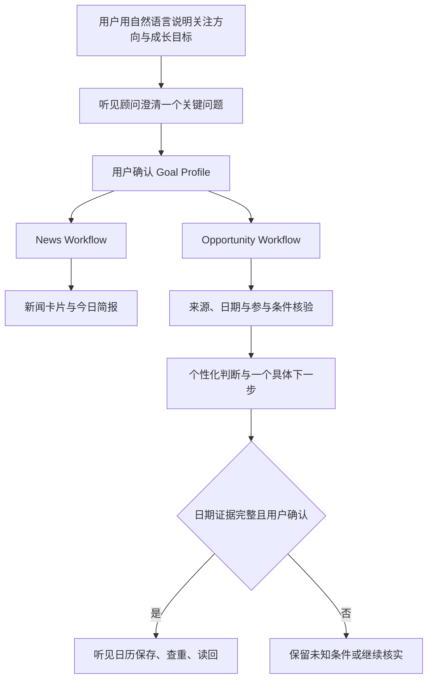

# 听见 TrendyHear

**Personal Motion Agent · 关注所爱，读懂今日。让信息不止被看见，更能转化为有意义的行动。**

[English](README.en.md) · 复赛提交版本 **v0.9.0** · SkyStream · [Apache-2.0](LICENSE)

听见 TrendyHear 是一款运行在 OctoSense 上的新闻聚合驱动个人成长Agent应用。它从公开资讯中筛选与用户目标相关的新闻和行动机会，再由“听见顾问小焦”结合已确认的个人背景，帮助用户回答两个问题：**这件事对我意味着什么？我现在最值得做什么？**

> The future of information is not about consuming more, but about turning the right information into meaningful action.
>
> 信息的未来，不在于消费更多的信息，而在于将真正重要的信息转化为有意义的行动。

**听见 TrendyHear 的产品定位**是 Personal Motion Agent。**小蕉（听见顾问）**是其人格化助手，负责理解需求、陪伴用户发现信息和行动机会。

“小焦”的名字取自“蕉”与“焦虑”的谐音。它面对的是信息爆炸带来的个人定位焦虑：减少无目的的信息噪音，从可信线索中找到可以核对、可以决定、可以执行的下一步。

## 版本状态

v0.9.0 是复赛提交冻结版本，开发与本地安装基线为 OctoSense `desktop-v0.1.0-rc.6-3-g243ee8c8`。当前仓库包括应用源码、Apache-2.0 许可证、启动说明、关键截图、需求说明、数据来源与限制、操作结果与失败状态记录。演示视频由参赛者完成后单独加入提交材料。

本地包使用既有测试信任链生成，只用于本机人工验收；它不是 App Hub 网络发布，也不代表官方审核已经通过。真实新闻内容、模型输出、实时活动来源和最终界面效果需要在固定包中人工核对。

## 产品升级：从信息到行动

初赛阶段，TrendyHear 是一个新闻聚合工具，主要帮助用户获取和理解资讯，并且按需推送信息卡片。进入复赛后，我们重新思考了新闻产品的终点：

**如果信息只是被阅读，然后被遗忘，那么再多的新闻，又能带来多少真正的成长？**

因此，v0.9.0 将 TrendyHear 升级为以个人成长目标为导向的 **Personal Motion Agent（个人行动智能体）**。用户可以告诉听见自己关注什么、希望实现什么；听见据此筛选资讯、生成今日简报，并进一步从信息中寻找与个人目标相关的行动机会。

例如，当用户希望学习 AI Agent 开发时，听见会帮助用户了解相关趋势，也会尝试发现值得参与的开发者活动、竞赛或研究项目，核对参与条件与关键日期，再结合用户已确认的个人背景给出一个具体的下一步。

通过听见日历的用户确认、日期证据、查重、保存和读回链路，有价值的信息可以继续转化为可核对、可安排的计划。

**从意图到信息，从信息到行动。**

## 产品主链




**自然语言意图 → 目标整理 → 用户确认 → 双工作流执行 → 事实与证据核验 → 个性化判断 → 用户授权 → 行动执行 → 结果读回。**

1. **理解意图。** 用户用自然语言描述关注领域、成长目标和现实限制。听见顾问提炼目标、近期重点与可选个人背景；只有确实影响推荐判断时，才追问一个低负担的关键问题。
2. **确认目标。** 顾问先生成 Goal Profile 确认卡片。用户确认后，目标版本、兴趣方向和已授权的个人上下文才会保存，后续步骤都引用这份已确认状态。
3. **协调执行。** 外层听见顾问以同一个目标版本启动 News 与 Opportunity 两条内部工作流。两条工作流可以独立成功、失败或返回空结果，不互相等待无关信息。
4. **处理新闻。** News Workflow 并行读取 RSS，完成格式解析、事件去重、语义筛选和相关性排序，再生成新闻卡片与今日文字简报。
5. **发现并核验机会。** Opportunity Workflow 并行读取活动来源、合并候选并核对页面证据。活动名称、资格、报名状态、形式、截止日期、作品要求和项目复用规则分别记录为 `verified`、`unverified` 或 `unknown`；单一来源异常会被隔离。
6. **形成个人判断。** 听见顾问只使用已确认目标、已授权个人背景和活动证据，综合判断目标价值、个人条件、现实障碍与当前最值得做的一步。缺失条件会明确保留为未知。
7. **支持用户决策。** 个性化分析直接显示在机会卡片中。新闻与机会只有在来源事实、活动要求或用户目标提供明确依据时才关联；用户可以继续核实、收藏、忽略或准备行动。
8. **执行并核对结果。** 对具有完整日期证据的机会，Action Layer 在用户确认后写入听见日历，执行查重、保存和读回。日期证据不足、用户未确认或保存失败时，流程停留在待核实或失败状态，不生成成功回执。

这条工作流通过目标版本、来源证据、任务状态、用户确认和执行回执保存上下文。每一步的结构化结果都会成为下一步的受约束输入，使“发现信息”能够继续推进到“判断价值”和“完成行动”。v0.9.0 采用一个外层听见顾问协调两条内部工作流，共享 Goal Profile、证据状态和 Action Layer。

News 与 Opportunity 是两条职责独立的工作流，共享同一份已确认目标，由外层听见顾问协调。应用不会因为新闻和活动主题相似就强行建立联系；只有来源事实、活动要求或用户目标提供明确依据时才关联。

## 核心能力

### 1. 自然语言目标与轻量个人上下文

用户可以直接告诉听见顾问关心的领域、希望达成的目标和现实限制。顾问先整理摘要并在应用中显示确认卡片，用户点击“确认保存”后才更新配置。

- 支持时政、商业、科技、社会、文化、教育及自定义方向。
- 行动机会默认覆盖会议、比赛、研究项目和实习就业；顾问会用一个低负担问题了解偏好。
- 当前阶段、已有资源和现实限制均为可选信息。
- 个人背景必须引用用户原话或已确认记录；未知信息不会被补成经验、能力、时间或预算。

### 2. 今日新闻与文字简报

“今日新闻”页从公开 RSS 中筛选最多八条相关或同领域延伸新闻，显示领域、标题、摘要、来源、时间、关键词和原文链接。新闻卡片采用左侧紧凑文字、右侧缩略图布局；没有来源图片时使用应用内默认插画。

- “生成今日简报”基于当前新闻重新生成 100–200 字文字简报。
- “立即更新”重新抓取、去重和筛选来源，并在筛选完成后自动生成新简报。
- 用户可以收藏、减少类似内容、标为已读或打开原文。
- 简报提醒支持 15 分钟后、30 分钟后和今日不再通知；选择后按钮立即折叠。
- 定时任务只在应用打开时检查，错过后在下次打开时补处理。

### 3. 行动机会核验

行动机会工作流先并行读取多个活动目录和官方页面，再轮询合并候选，避免先返回的单一来源占满结果。v0.9.0 为来源阶段增加单源超时、总超时、异常隔离和可见进度；单个来源格式异常不会让整个页面一直停在“正在寻找”。

每个机会字段分别保留状态：

| 状态 | 含义 |
| --- | --- |
| `verified` | 有当前来源原文明确支持 |
| `unverified` | 存在线索，但尚未完成核验 |
| `unknown` | 当前没有获得该信息 |

应用尽可能核对活动名称、链接、类型、主题、报名状态、参与资格、形式、报名与提交截止时间、作品要求和项目复用规则。字段缺失时保留未知；已确认结束或过期的活动不展示。聚合目录只用于发现，不自动等同于主办方官网。

### 4. 听见顾问的个人判断

每张准备展示的机会卡片直接显示顾问气泡，无需再点击“生成分析”。判断内部覆盖四个问题：

1. 这项机会能帮助用户推进什么目标？
2. 用户有哪些已经确认的条件可以帮助参与？
3. 哪些障碍已经确认，哪些条件仍待核实？
4. 当前最值得做的一件具体事情是什么？

决策支持包括“值得优先考虑”“先核实关键条件”“保留关注”“暂不投入”和“证据不足”。缺少资格信息不会被解释为用户不符合资格；背景不足时使用条件句给出仍然有用的分析。

### 5. 听见日历与系统日历实验入口

日期完整、原文证据匹配且报名状态核验为开放的机会，可以由用户确认加入“听见日历”。应用按机会、日期和类型查重，写入后立即读回；只有读回一致才显示成功。用户可在月份视图中查看或删除日程。

听见日历属于 TrendyHear 本身，数据保存在应用目录中。机会页同时保留“打开系统日历”的实验入口；该入口只尝试让 OctoSense Shell 打开相应应用，不传送听见日程，也不作为跨应用 Calendar 已跑通的证明。历史实验、失败原因和待验证方案保存在 [Calendar 实验记录](docs/platform-calendar/README.md)。

### 6. 收藏、反馈与历史

收藏与阅读历史在本地保存。用户可以取消收藏、再次打开原文，并通过“减少此类”影响后续新闻筛选。刷新新闻、重新生成简报和重新查找机会不会清空这些记录。

## 技术架构

- **界面与工作流：** OctoScript / Splash。
- **宿主：** OctoSense rc.6，使用 `script-tools-v1` 与 `host-api-v1`。
- **协调方式：** 一个外层 Orchestrator 加 News、Opportunity 两条独立专业工作流。
- **模型：** 由用户在 OctoSense 中配置；应用不读取或保存模型密钥。
- **数据：** 兴趣、确认背景、新闻、收藏、历史、机会证据、对话与听见日程保存在应用私有目录。
- **安全约束：** 模型不能生成新的官方链接或日历日期；用户文本和网页文本均视为数据，不作为系统指令执行。

关键入口：

| 文件 | 作用 |
| --- | --- |
| `bundle/main.splash` | UI、News/Opportunity 工作流、分析、收藏、历史与听见日历 |
| `bundle/AGENT.md` | 听见顾问的对话边界、确认流程与个人判断要求 |
| `bundle/tools.json` | 顾问向应用提出目标或偏好草稿的结构化工具 |
| `bundle/manifest.json` | 能力、网络域名、版本和包完整性 |
| `bundle/listing.json` | App Hub 展示信息、图标与截图 |

## 数据来源

### 新闻

- 中国新闻网：时政、教育、社会、即时、国际、财经、文化 RSS。
- IT之家 RSS。
- 爱范儿 RSS。
- Solidot RSS。

### 行动机会

- Hackalendar：AI、学生、创意、数据、全球线上及综合活动目录。
- FOSS United Events：开源社区活动。
- Symposia / Conferencely：技术与学术会议目录。
- grants.watch：研究资助线索。
- Jobicy：远程实习线索。

各来源可能出现网络失败、限流、结构变化、重复条目或覆盖不足。详情见 [数据来源与限制](submission/数据来源与限制/数据来源与限制.md)。

## 安装与启动

### 环境

1. macOS 上的 OctoSense rc.6 测试宿主。
2. 可用的 OctoSense 模型配置。
3. 用于检查应用包的 OctoScript App Design Flow 与 App Hub 工具。

### 从源码检查

```sh
/path/to/OctoScript-App-Design-Flow/tools/octo doctor
/path/to/OctoScript-App-Design-Flow/tools/octo check bundle
```

`check` 只验证包结构和静态规则，不执行真实模型、网络来源或人工交互。

### 本机冻结包

完成签名后，本机人工验收包位于：

```text
build/install-0.9.0-local/OctoSense-Test-0.9.0.app
```

打开该应用后，从 App Hub 安装或打开 TrendyHear。测试目录与官方 OctoSense 目录隔离，不修改官方安装，也不上传网络。正式公开安装应遵循 App Hub 的发布和信任流程。

## 建议验收路径

1. 打开听见顾问，用自然语言描述一个成长目标。
2. 检查顾问是否只问一个会影响判断的关键问题，再确认保存。
3. 在“今日新闻”页更新新闻并生成文字简报；收藏一条新闻并查看历史。
4. 在“行动机会”页观察来源进度和结果；打开详情核对字段状态与原文。
5. 比较不同已确认背景下，同一机会的分析是否实质不同。
6. 对具有完整日期证据的机会确认加入听见日历，检查月份视图与读回结果。
7. 复现至少一个失败状态，确认应用不把未知或失败显示成成功。

自动回归使用：

```sh
python3 tests/run_native_checks.py --octo /path/to/OctoScript-App-Design-Flow/tools/octo
```

测试以构造数据调用正式校验与存储函数，不请求真实模型，因此不能替代人工验收。当前结果和仍待人工核对的项目见 [v0.9.0 验证记录](docs/VALIDATION-0.9.0.md)。操作、可核对结果及失败状态见 [复现与核对](submission/操作与结果证据/复现与核对.md)。

## 隐私与权限

- 模型密钥由 OctoSense 宿主管理，TrendyHear 不读取密钥。
- 公开候选内容、用户确认的目标和必要的个人背景会交给宿主模型分析。
- 未经确认的个人背景不会持久化为分析依据。
- 听见日历不申请 macOS、iCloud 或 Exchange 日历权限。
- `build/` 中的本地测试状态和密钥不属于公开源码交付内容。

完整说明见 [PRIVACY.md](PRIVACY.md)。

## 已知限制

- 活动来源覆盖有限，空结果不代表互联网上没有相关机会。
- 聚合目录中的资格、状态和日期需要继续以官方页面核验。
- 尝试后台定时抓取与提醒时，当前 OctoSense 宿主没有向应用提供可验收的后台唤醒与通知权限；因此应用关闭期间不运行，重新打开后按当前规则补处理。
- 经过多轮测试与界面调整，部分 UI/UX 细节仍未达到预期，例如新闻卡片在部分窗口尺寸下内容间距仍显宽松，后续需要继续优化信息密度与跨尺寸排版。
- 曾尝试为今日简报接入语音合成并进行真实运行验收，但生成耗时较长且未获得可播放结果，因此 v0.9.0 未将语音朗读纳入正式功能，相关过程作为失败状态记录保留。
- 缩写日期区间等有歧义的日期不开放日程写入。
- 桌面端与 Android 的自适应导航仍有限；早期抽屉方案无法在两种窗口形态间稳定切换，因此 v0.9.0 采用统一底部导航，抽屉补丁仅作为失败实验保留。
- 曾尝试通过 OctoSense 系统 Calendar 跨应用创建、查重和读回事件，但受权限与 Shell 能力限制无法稳定验收，因此正式链路收敛为 TrendyHear 内置的听见日历；系统 Calendar 入口保留，相关方案仅作为实验记录。
- Android 仍需真机人工验收。

## 提交材料

复赛材料清单见 [submission/提交清单.md](submission/提交清单.md)。当前仓库已经整理源码、许可证、启动说明、截图、需求说明、数据来源、操作结果和失败状态；演示视频待参赛者录制并在最终上传前补入。

## 仓库结构

```text
bundle/       正式应用包：脚本、顾问指令、工具、资源和截图
docs/         当前验证、更新记录与历史技术实验
submission/   复赛提交说明和操作证据；视频暂不纳入冻结包
tests/        原生隔离回归
build/        本机测试、历史预览与签名目录，不纳入公开源码包
artifacts/    历史冻结制品
```

## 许可证与支持

TrendyHear 源码以 [Apache License 2.0](LICENSE) 发布。第三方新闻、活动内容和链接仍属于各自权利人，不因本项目许可证而改变。

源码仓库：[TrendyHear](https://github.com/Leah698/TrendyHear) · 问题反馈：[Issues](https://github.com/Leah698/TrendyHear/issues)
